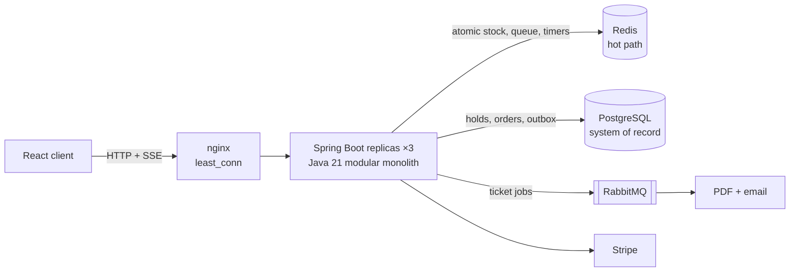

# FlashSeats


In a flash sale, 10,000 buyers reach 500 seats in the same second, and a conventional web shop
either stalls or keeps selling after the stock is gone. FlashSeats is a ticketing engine built to
stay correct under that burst, across horizontally scaled replicas and up to ten concurrent sales.

**Three guarantees, each enforced in the data layer and proven by tests:**

1. **No oversells.** A seat is reserved by one atomic operation, under any load or failure.
2. **No orphan charges.** Every charge ends confirmed or refunded, never both and never neither.
3. **Immediate feedback.** Buyers see their live queue position and learn the moment stock runs out.

## Product preview

<!-- Optional: replace this grid with a short GIF of the buyer journey (docs/images/demo.gif). -->

<table>
  <tr>
    <td width="33%" valign="top"><p><b>Waiting room.</b> Live position over SSE; a refresh keeps the place.</p></td>
    <td width="33%" valign="top"><p><b>Declined card.</b> Seats stay held while the buyer retries.</p></td>
    <td width="33%" valign="top"><p><b>Ticket email.</b> PDF rendered and sent asynchronously.</p></td>
  </tr>
  <tr>
    <td width="33%" valign="top"><p><b>Event page.</b> Tiers with coarse availability and a server-clock countdown.</p></td>
    <td width="33%" valign="top"><p><b>Seat selection.</b> Reserving places a five-minute hold.</p></td>
    <td width="33%" valign="top"><p><b>Operator console.</b> Create, pause, rebuild and delete sales.</p></td>
  </tr>
</table>

## Architecture overview



- **Modular monolith, not microservices.** One deployable confirms an order, consumes its hold
  and queues its ticket in a single PostgreSQL transaction instead of a distributed saga. Nine modules talk only through facades,
  and Spring Modulith fails the build if a boundary is crossed, so the system can still be split
  later.
- **Redis is fast, PostgreSQL is the truth.** Stock is decremented by one atomic Lua script in
  Redis; holds, orders and payments live in PostgreSQL. Redis state can always be rebuilt from the
  ledger. The trade-off: a Redis restart pauses affected sales until an operator rebuilds them,
  because selling against a counter that may have lost writes is worse than pausing.
- **Fulfilment is asynchronous.** A transactional outbox hands confirmed orders to RabbitMQ, so
  checkout never waits on PDF rendering or a mail server, and a crash never loses a ticket.
- **Stateless replicas and a paced waiting room.** Any replica serves any request, with live
  updates fanned out over Redis pub/sub. A cluster-wide admission budget keeps 10,000 buyers from
  exhausting the connection pool, and Java 21 virtual threads hold thousands of open SSE streams
  cheaply.

## Performance and correctness proof

Five concurrent sales of 500 seats, three replicas, load generated by k6 on a single 10-core host:

| Check | Result |
| :--- | :--- |
| Seats sold at 300 / 2,000 / 10,000 buyers | 2,500 of 2,500 each time, **0 oversold** |
| Stock invariant (sold + held + remaining = capacity) | Exact on every tier, every run |
| Checkout p99 at 300 / 2,000 buyers | 70 ms / 195 ms |
| Checkout p99 at 10,000 buyers | 7.6 s, bound by the shared host CPU, not the connection pool |
| Hold expiry seen by all three replicas | Seats restored exactly once |
| Redis failover | Selling stops with a retryable `503` until rebuilt, never a false "sold out" |
| Automated tests | 320 backend (real PostgreSQL, Redis, RabbitMQ), 78 frontend, 27 browser E2E |

Profiling the 10,000-buyer drill raised sell-through from 22–28 % to 100 %. The cause was
connection churn and instrumentation overhead on the hottest endpoint, not the database.

## Tech stack

- **Backend:** Java 21 (virtual threads), Spring Boot 4.1, Spring Modulith, Spring Security
- **Data:** PostgreSQL 16 with Flyway, Redis 7 with Sentinel
- **Messaging:** RabbitMQ with dead-letter queues, transactional outbox
- **Payments and resilience:** Stripe (3-D Secure), Resilience4j, Bucket4j, reCAPTCHA v3
- **Frontend:** React 18, TypeScript, MUI, Vite
- **Infrastructure:** Docker Compose, nginx, GitHub Actions CI, images on GHCR
- **Testing and observability:** JUnit, Testcontainers, Vitest, Playwright, k6, Micrometer, Prometheus

## Quick start

Requires Docker (8 GB of memory) and a POSIX shell.

```bash
git clone https://github.com/eshedhayoun/FlashSeats.git && cd FlashSeats
docker/scripts/demo.sh    # starts a 3-replica cluster with two open sales
```

- Buyer app: http://localhost:8080
- Operator console: http://localhost:8080/admin (`admin` and the password the script prints)
- Ticket inbox (Mailpit): http://localhost:8025

## Documentation

| Document | Covers |
| :--- | :--- |
| [Architecture](docs/architecture.md) | Requirements, design principles, modules, Redis keys, core mechanisms, invariants, failure modes, security |
| [API](docs/api.md) | Endpoints, SSE events, error codes |
| [Operations](docs/operations.md) | Development setup, configuration, tests, load testing, monitoring, runbook, limitations |
| [Frontend](frontend/README.md) | The React client |