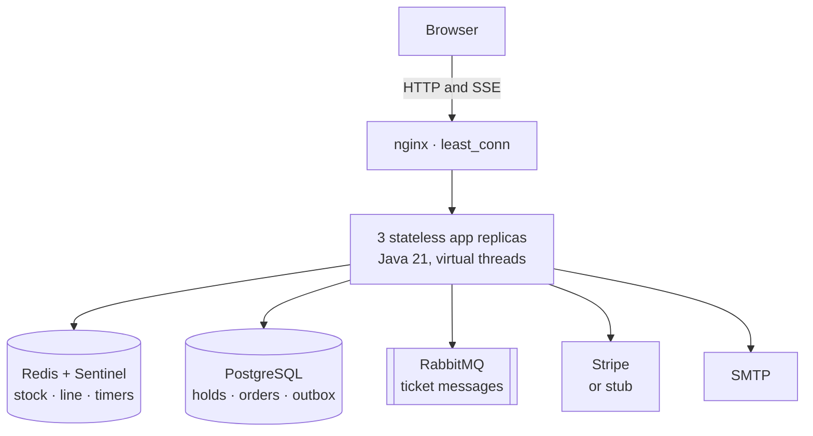

# FlashSeats

**A ticket flash-sale engine that stays correct when 10,000 buyers hit 500 seats in the same second.**

[](https://github.com/eshedhayoun/FlashSeats/actions/workflows/ci.yml)


[](LICENSE)

FlashSeats sells exactly the inventory it has. No seat is oversold, no buyer is charged without a
ticket, and buyers who miss out are told immediately. It runs as a horizontally scaled Java 21 /
Spring Boot 4 modular monolith behind nginx, with PostgreSQL as the system of record, Redis for the
hot path, RabbitMQ for fulfilment, and a React client.

| 10,000 | 2,500 / 2,500 | 0 | 3 replicas | 425 |
| :---: | :---: | :---: | :---: | :---: |
| concurrent buyers | seats sold | oversold | stateless, any request on any node | automated tests and specs |

## Product

<table>
  <tr>
    <td width="33%" valign="top"><p><b>Waiting room.</b> Live position over SSE; a refresh keeps the place.</p></td>
    <td width="33%" valign="top"><p><b>Declined card.</b> Seats stay held while the buyer retries.</p></td>
    <td width="33%" valign="top"><p><b>Ticket email.</b> PDF rendered and sent asynchronously via RabbitMQ.</p></td>
  </tr>
  <tr>
    <td width="33%" valign="top"><p><b>Event page.</b> Tiers with coarse availability, server-clock countdown.</p></td>
    <td width="33%" valign="top"><p><b>Seat selection.</b> A ten-minute admission; reserving places a five-minute hold.</p></td>
    <td width="33%" valign="top"><p><b>Operator console.</b> Create, pause, rebuild and delete sales.</p></td>
  </tr>
</table>

## Capabilities

- **Zero oversell under any load or failure.** Seats are reserved by a single atomic Redis
  operation. A missing stock counter halts the sale rather than reporting it sold out.
- **Exactly-once payments.** Every settled charge ends confirmed or refunded, never both, including
  when checkout and the provider webhook race to settle it.
- **Fair, live waiting room.** Idempotent joins, real-time positions over Server-Sent Events, and
  cluster-wide admission pacing that keeps the database connection pool from saturating.
- **Horizontal scale.** 3–10 concurrent sales on stateless replicas. Timers, notifications and seat
  restoration execute once per cluster, not once per node.
- **End-to-end purchase flow.** Event page, waiting room, seat hold, payment (Stripe with
  3-D Secure, or a built-in stub), and a PDF ticket by email, plus an operator console.
- **Abuse controls that spare shared networks.** Session-first rate limiting with a per-IP backstop,
  IP rules, and reCAPTCHA v3 on join.

## Architecture



**PostgreSQL is the authority** for every lifecycle: holds, orders, payments and the outbox.
**Redis holds fast, reconstructible state**: stock counters, the waiting room and timers. The
backend is nine modules that communicate only through facades, with boundaries enforced at build
time by Spring Modulith.

| Layer | Technology |
| :--- | :--- |
| **Backend** | Java 21 (virtual threads), Spring Boot 4.1, Spring Modulith 2.1, Spring Security |
| **Data** | PostgreSQL 16 (Flyway), Redis 7 with Sentinel |
| **Messaging** | RabbitMQ 3.13 with dead-letter queues |
| **Payments and resilience** | Stripe, Resilience4j circuit breakers, Bucket4j rate limits, reCAPTCHA v3 |
| **Fulfilment** | PDFBox, SMTP |
| **Frontend** | React 18, TypeScript, MUI 6, Vite |
| **Delivery** | Docker Compose, nginx, GitHub Actions CI, multi-arch images on GHCR |
| **Quality and observability** | JUnit + Testcontainers, Vitest, Playwright, k6, Micrometer, Prometheus |

### Core mechanisms

| Problem | Solution | Verified by |
| :--- | :--- | :--- |
| Thousands of buyers race for the last seat | One Redis Lua script reads, compares and decrements atomically ([`stock_reserve.lua`](src/main/resources/redis/stock_reserve.lua)) | [`StockReserveConcurrencyIT`](src/test/java/com/flashseats/catalog/StockReserveConcurrencyIT.java) |
| Every replica sees the same hold expire | A conditional `UPDATE … WHERE status = 'ACTIVE'`; only the winner restores the seats, after commit ([`TicketHoldRepository`](src/main/java/com/flashseats/hold/repository/TicketHoldRepository.java)) | [`HoldLifecycleIT`](src/test/java/com/flashseats/hold/HoldLifecycleIT.java) |
| Checkout and the webhook settle the same charge | Every order transition is a compare-and-set on the `orders` row ([`OrderCommitService`](src/main/java/com/flashseats/order/service/OrderCommitService.java)) | [`SettlementArbiterIT`](src/test/java/com/flashseats/order/SettlementArbiterIT.java) |
| A traffic spike would exhaust the connection pool | A Redis sorted-set waiting room drawing on one cluster-wide admission allowance ([`PromotionWorker`](src/main/java/com/flashseats/queue/service/PromotionWorker.java)) | [`GlobalPromotionBudgetIT`](src/test/java/com/flashseats/queue/GlobalPromotionBudgetIT.java) |
| A buyer's live connection is on another replica | SSE, with promotions fanned out over Redis pub/sub ([`QueueBroadcaster`](src/main/java/com/flashseats/queue/service/QueueBroadcaster.java)) | [`fanout-check.sh`](docker/scripts/fanout-check.sh) |
| A confirmed order must always produce a ticket | Transactional outbox (`FOR UPDATE SKIP LOCKED`) to RabbitMQ, with insert-then-send deduplication ([`OutboxRelay`](src/main/java/com/flashseats/order/service/OutboxRelay.java)) | [`OutboxRecoveryIT`](src/test/java/com/flashseats/order/OutboxRecoveryIT.java) |
| Nine modules must stay decoupled | Facade-only calls, verified by Spring Modulith | [`ModularityTests`](src/test/java/com/flashseats/app/ModularityTests.java) |

Full design: requirements, module ownership, Redis key map, invariants, failure modes and security
in [`docs/architecture.md`](docs/architecture.md).

## Performance

Five concurrent sales of 500 seats each, three replicas, measured with k6 on a single 10-core host:

| Buyers | Sold | Oversold | Checkout p50 / p99 |
| :--- | :--- | :--- | :--- |
| 300 | 2,500 / 2,500 | 0 | 10 ms / 70 ms |
| 2,000 | 2,500 / 2,500 | 0 | 14 ms / 195 ms |
| 10,000 | 2,500 / 2,500 | 0 | 1.2 s / 7.6 s |

Inventory was exact on every tier at every load level. Checkout p99 stays under 200 ms through
2,000 buyers; at 10,000 the bottleneck is the host CPU, which the load generator shares, while the
connection pool never queued. Multi-replica fan-out, exactly-once hold expiry, Redis failover and a
Stripe test-mode run are each verified by a dedicated script.
[Methodology and full results](docs/operations.md#5-load-testing).

**Profiling impact.** An earlier build sold only 22–28 % of seats at 10,000 buyers. Profiling
traced it not to the database but to two new TCP connections per request on the hottest endpoint
and to per-request instrumentation consuming a quarter of CPU samples. Removing both brought
sell-through to 100 %.

## Quick start

Requires Docker (8 GB of memory) and a POSIX shell.

```bash
git clone https://github.com/eshedhayoun/FlashSeats.git && cd FlashSeats
docker/scripts/demo.sh    # generates secrets, starts a 3-replica cluster, opens two sales
```

| URL | |
| :--- | :--- |
| http://localhost:8080 | Buyer experience |
| http://localhost:8080/admin | Operator console (`admin` and the password the script prints) |
| http://localhost:8025 | Mailpit inbox for ticket emails |

Payments run against a built-in stub that covers success, decline, provider outage and 3-D Secure.
Stripe test mode is a configuration switch.

### Development

Requires JDK 21 and Node 22.

```bash
cp .env.example .env
docker/scripts/dev-up.sh                    # infrastructure and one open sale
./mvnw spring-boot:run                      # API on :8080
cd frontend && npm install && npm run dev   # client on :5173
```

| Suite | Command | Coverage |
| :--- | :--- | :--- |
| Backend unit and integration | `./mvnw test` | 320 tests on real PostgreSQL, Redis and RabbitMQ |
| Frontend unit | `cd frontend && npm test` | 78 tests |
| Browser end-to-end | `cd frontend && npm run test:e2e` | 27 specs, desktop and mobile |

CI runs every suite on each pull request and publishes images to GHCR on merge. Configuration,
Stripe, SMTP, monitoring and the operator runbook are in [`docs/operations.md`](docs/operations.md).

## Design principles

- **Correctness lives in the data layer.** The queue manages load; correctness comes from
  constraints, conditional updates and atomic scripts, never from call-site discipline.
- **Overload degrades latency, never correctness.** At 10,000 buyers latency rose to seconds while
  inventory stayed exact.
- **Fail closed on money and stock, fail open on load shedding.** A Redis restart pauses affected
  sales until counters are rebuilt from the ledger; an unreachable reCAPTCHA lets buyers through.
- **Distributed behaviour is tested distributed.** Notification fan-out and seat restoration are
  verified against a live three-replica cluster, where single-node tests cannot reach.

### Trade-offs

Some scope is deliberately left out: buyers are anonymous (session cookie and emailed receipt
link), operators share a single account, and sales are immutable once created. Checkout halts during
a Redis outage, because selling against a counter that may have lost writes is worse. The latency
figures at 10,000 buyers reflect one shared host; the system's own ceiling needs a dedicated load
generator to measure. See
[known limitations](docs/operations.md#8-known-limitations).

## Documentation

| Document | Covers |
| :--- | :--- |
| [`docs/architecture.md`](docs/architecture.md) | Requirements, deployment, modules, Redis keys, mechanisms, invariants, failure modes, security, conventions |
| [`docs/api.md`](docs/api.md) | Endpoints, SSE events, error codes |
| [`docs/operations.md`](docs/operations.md) | Running, configuration, tests, load testing, monitoring, runbook, limitations |
| [`frontend/README.md`](frontend/README.md) | The React client |