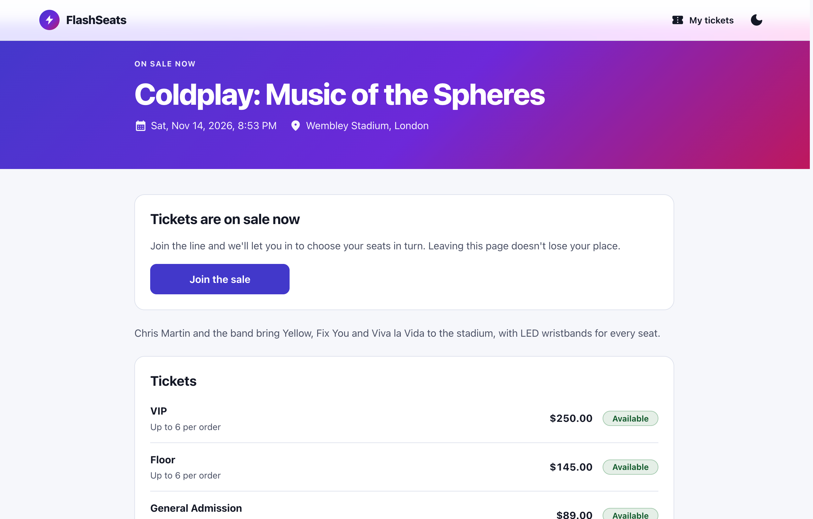
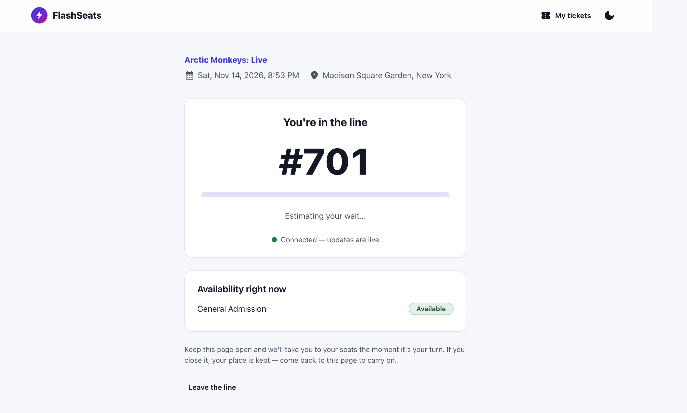
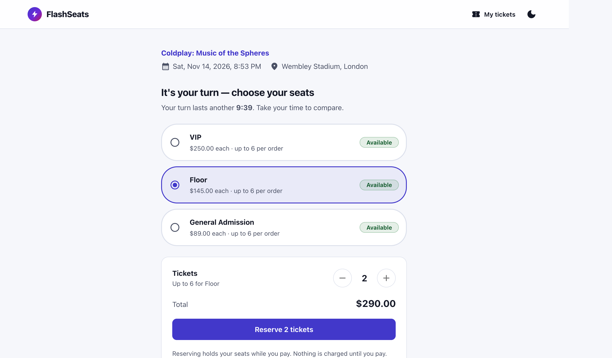
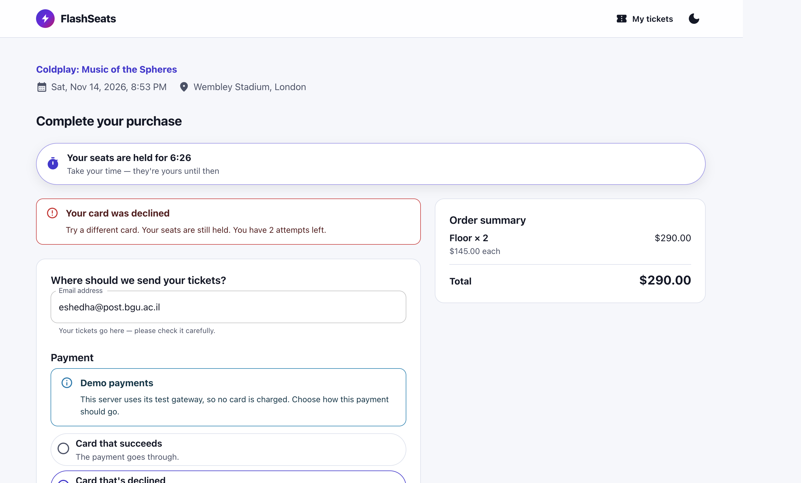
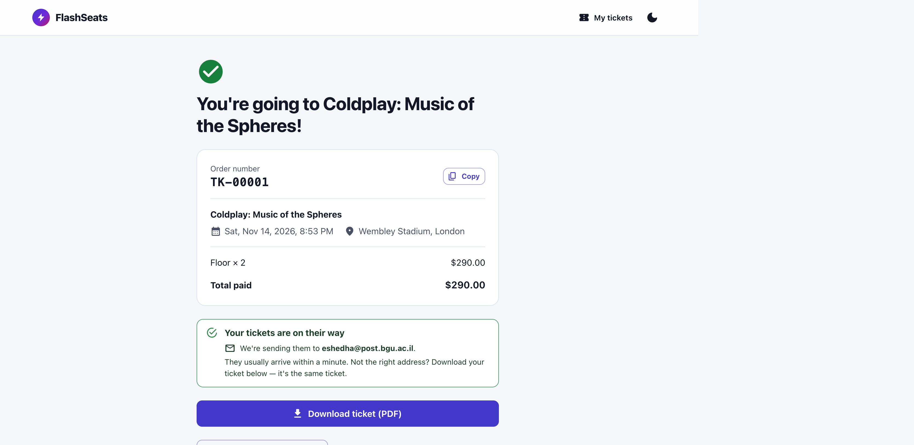
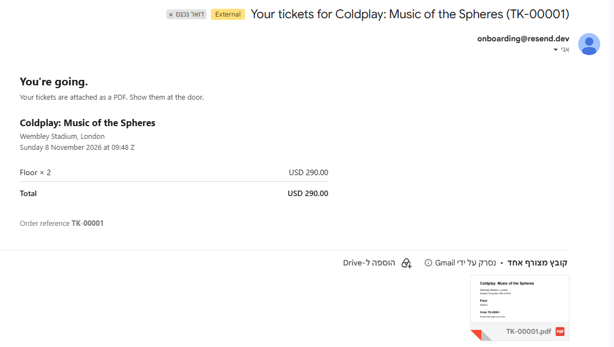

# FlashSeats

**Team members:** Eshed Hayoun · Adar Gerbi · Shoham Sherer

FlashSeats is a high-concurrency ticket flash-sale engine. **10,000 people want 500 tickets, and
they all arrive in the same second.** Exactly 500 must sell, nobody may be charged for a seat they
did not get, and the 9,500 who miss out must find out quickly. The system is built as a modular
monolith on Java 21 and Spring Boot 4, runs as three replicas behind nginx, and has a React client.

**Quick start.** You need only Docker and a POSIX shell (Git Bash on Windows):

```bash
docker/scripts/professor-demo.sh     # secrets, a three-replica cluster, two open sales; prints the admin password
open http://localhost:8080           # the React client: event page, waiting room, checkout, PDF ticket
open http://localhost:8025           # the local Mailpit inbox, where the ticket email arrives
```

## Contents

1. [Introduction](#1-introduction)
2. [System Specification](#2-system-specification)
3. [Implementation](#3-implementation)
4. [Demonstration](#4-demonstration)
5. [Conclusions](#5-conclusions)
- [Appendix A: Documentation](#appendix-a-documentation)
- [Appendix B: Running and Development](#appendix-b-running-and-development)

---

## 1. Introduction

### 1.1 The problem

In a flash sale, a fixed number of tickets goes on sale at an announced moment, and demand exceeds
supply many times over. For a popular concert, nearly all the traffic of the whole sale arrives in
its first seconds. A conventional web shop is built for steady traffic. Under this burst, it
either slows down until nobody can buy, or, worse, keeps selling after the tickets are gone.

### 1.2 Why it is hard

- **Overselling.** Thousands of requests read "1 seat left" at the same moment. Unless the reserve
  is a single atomic step, more than one of them succeeds.
- **Charging without delivering.** A payment can succeed while the order fails to save, or a buyer
  can retry and be charged twice. Every path that moves money has to end exactly one way:
  confirmed or refunded.
- **The stampede.** If 10,000 buyers reach checkout at once, the database connection pool is gone
  in milliseconds and nobody completes a purchase. Admission has to be paced.
- **Many servers, one truth.** Several application replicas serve the same sale. Timers, waiting-room
  notifications and seat restoration must happen exactly once, not once per replica.
- **Bots and abuse.** Scripts try to jump the line, and rate limits must stop them without
  blocking a whole university behind one NAT address.

### 1.3 Project goals

1. **Correctness first:** never oversell, never charge without a ticket, never lose a sold seat.
2. **A complete journey:** from the event page to a PDF ticket in the buyer's inbox.
3. **Fair and informative waiting:** a queue with a live position, and a clear "sold out" the
   moment the stock runs out.
4. **Horizontal scale:** stateless replicas, with 3–10 sales running at the same time.
5. **Evidence:** every guarantee checked by an automated test or a measured load drill.

### 1.4 What we built

The backend is a Spring Boot modular monolith with nine modules. Each module owns its own data, and
the module boundaries are verified at build time. PostgreSQL stores the durable ledger: holds,
orders, payments and the outbox. Redis stores the live stock counters and the waiting room.
RabbitMQ carries ticket fulfilment off the request path. A React client implements the buyer's
journey. Payments go through a provider abstraction: an in-process stub by default, with real
Stripe (including 3-D Secure) behind a single setting. The whole system starts with one command.

---

## 2. System Specification

### 2.1 Actors

| Actor | What they do |
| :--- | :--- |
| **Buyer** | An anonymous visitor identified by a signed session cookie. Browses events, joins the waiting room, reserves seats, pays, and receives a PDF ticket by email |
| **Operator** | Authenticated through the admin API. Pre-warms a sale, pauses and resumes it, rebuilds stock counters after a fault, replays failed notifications, manages IP rules |
| **Payment provider** | The stub gateway or Stripe. Charges, refunds, and reports late settlements by webhook |

### 2.2 Functional requirements: the buyer's journey

```
landing (countdown, server clock)
   └─► join sale ──► bot gate (captcha + rate limits)
          └─► waiting room  ── live positions (SSE) ──► promoted
                 └─► queue pass (120 s, single-use)
                        └─► admission session (600 s — browse freely)
                               └─► select tier ──► hold (300 s, atomic decrement)
                                      └─► checkout ──► charge ──► confirm order
                                             └─► receipt
                                                    └─► async: RabbitMQ → PDF → email
```

- **Waiting room.** Joining is idempotent: refreshing the page keeps the buyer's place. The
  position updates live over Server-Sent Events (SSE), with polling as a fallback.
- **Three nested timers.** A *queue pass* (120 s) lets a promoted buyer in once. It becomes an
  *admission session* (600 s), in which the buyer can compare tiers, reload the page, or release a
  hold and choose again without losing their place. A *hold* (300 s) reserves specific seats while
  the buyer pays.
- **Checkout.** The price is computed on the server. A declined card **keeps the seats**, so the
  buyer can retry with another card. If the seats are lost after a successful charge, the charge is
  refunded.
- **Recovery.** `GET /api/v1/sale/{eventId}/state` returns the buyer's exact position in the
  journey, so a page reload or a lost connection costs nothing.
- **Fulfilment.** A confirmed order produces a PDF ticket, delivered by email and downloadable from
  the receipt page.
- **Operations.** An operator can pause a sale without ending it: the line keeps its order, holds
  wait, and payments in progress complete.

The full journey, with every edge case, is in [`docs/03-end-to-end-flow.md`](docs/03-end-to-end-flow.md).

### 2.3 Non-functional requirements

| Requirement | Target |
| :--- | :--- |
| **No oversell** | Zero, under any load, any failure, and any number of replicas |
| **Exactly-once money** | Every settled charge ends confirmed or refunded, never both and never neither |
| **Concurrency** | 3–10 sales open at the same time; 10,000 buyers across them |
| **Latency** | Checkout p99 under 200 ms at normal load |
| **Horizontal scale** | Stateless replicas; any replica can serve any request |
| **Fault behaviour** | Failures that could cause an oversell stop sales rather than guess. Load-shedding components fail open |
| **Abuse resistance** | Session-first rate limits with a loose per-IP backstop; a challenge check on join |
| **Errors** | Every error is an RFC 7807 problem document with a stable error code |

### 2.4 Correctness invariants

These hold at all times, and the tests and drills check them:

1. `confirmed_sold + active_holds + remaining == total_capacity`, for every tier.
2. No order without exactly one settled hold.
3. No charge without an order row.
4. No confirmed order without an outbox row, so a confirmed order always produces a ticket.
5. Stock is restored **exactly once** per hold.
6. Module dependencies stay acyclic (`ApplicationModules.verify()`).

Invariant 1 is exported as the `flashseats.stock.drift` metric. Only a *sustained* non-zero value
counts as a fault: Redis and PostgreSQL are not read in one snapshot, so a single sample can catch a
hold in flight.

### 2.5 Scope and assumptions

- **Payments** use the in-process stub by default, which drives every branch: success, decline,
  provider outage, and 3-D Secure. Real Stripe runs in test mode behind `STRIPE_ENABLED=true`.
- **Email** goes to a local Mailpit inbox by default. Real delivery through any SMTP relay is a
  configuration change, not a code change.
- **Buyers are anonymous.** Identity is a signed session cookie; there are no buyer accounts.
- **The operator surface is an authenticated HTTP API.** There is no admin UI.

---

## 3. Implementation

### 3.1 Technology stack

| Layer | Technology |
| :--- | :--- |
| **Backend** | Java 21 with virtual threads, Spring Boot 4.1.1, Spring Modulith 2.1.1, Spring Security |
| **Data** | PostgreSQL 16 (Flyway migrations), Redis 7 (one primary with Sentinel, not Cluster) |
| **Messaging** | RabbitMQ 3.13 with dead-letter queues |
| **Payments** | Stripe Java 29.2.0, Resilience4j 2.3.0 circuit breakers |
| **Abuse control** | Bucket4j 8.14.0 (Redis-backed), reCAPTCHA v3 |
| **Fulfilment** | PDFBox 3.0.7, SMTP (Mailpit locally) |
| **Frontend** | React 18, TypeScript, MUI 6, Vite |
| **Infrastructure** | Docker Compose, nginx (`least_conn`), three application replicas |
| **Observability** | Spring Actuator, Micrometer, Prometheus |
| **Testing** | JUnit with Testcontainers 1.21.3, Vitest, Playwright, k6 |

All backend dependencies are declared in [`pom.xml`](pom.xml), with the reason beside any that was
removed.

### 3.2 Architecture

```
                              [ browser ]
                                   │
                         [ Nginx · least_conn ]
                          proxy_buffering off
                                   │
              ┌────────────────────┼────────────────────┐
         [ app 1 ]            [ app 2 ]            [ app 3 ]
                    stateless · Java 21 virtual threads
              └────────────────────┼────────────────────┘
              ┌────────────────────┼────────────────────┐
        [ Redis 7 ]        [ PostgreSQL 16 ]      [ RabbitMQ ]
     primary + Sentinel      AOF everysec        DLX + DLQ
     stock · queue ·         orders · outbox     PDF + email
     holds · buckets         audit ledgers
```

The application replicas hold no state between requests. PostgreSQL is the authority for every
lifecycle: holds, orders, payments. Redis holds fast, reconstructible state: the stock counters, the
waiting room, and timers. If all of Redis is lost, PostgreSQL plus an operator rebuild restores it.

### 3.3 Modules

| Module | Owns | Storage |
| :--- | :--- | :--- |
| `bot` | Rate limits, IP rules, the challenge check on join | PG + Redis |
| `catalog` | Events, tiers, sale windows, **inventory** | PG + Redis |
| `queue` | Waiting room, SSE, signed passes, admission control | Redis only |
| `hold` | Time-bound reservations, settle-once stock restoration | PG + Redis |
| `payment` | Payment provider, idempotency, webhooks, refunds | PG + Redis |
| `order` | The order ledger, **checkout orchestration**, outbox | PG only |
| `notification` | PDF tickets, email, dead-letter replay | PG + RabbitMQ |
| `saleflow` | Read-only "where am I in the sale" endpoint | none |
| `shared` | Open module: error codes, session identity, signed tokens, clock, PDF renderer | none |

Modules call each other only through a facade interface, and each module reads only its own tables
and Redis keys. The dependency graph is acyclic, and the build verifies it:

```
                    shared        ← open module; everyone may depend on it

bot      ──► shared only
queue    ──► catalog, bot         ← `bot` only on join
hold     ──► queue, catalog
order    ──► hold, catalog, payment, queue
saleflow ──► queue, hold, order, catalog     ← read-only leaf
payment  ──( PaymentSettledEvent · webhook path only )──► order
order    ──( outbox → RabbitMQ )──► notification
```

The last two arrows are **not** facade calls. One is a Spring event, the other a message that
RabbitMQ delivers. As facade calls, either would close a cycle, so neither is one.

### 3.4 Key mechanisms

**1. Overbooking is prevented by an atomic reserve, not by the queue.**
The queue exists so that 9,500 people do not hit checkout at once, and so that they learn their
fate quickly. Correctness comes from `stock_reserve.lua`, a Redis script that reads the counter,
compares, and decrements in one atomic step, refusing to go below the requested quantity. The live
count exists only in Redis, under `catalog:stock:{event}:{tier}`, and only the `catalog` module
changes it.

**2. Exactly one replica restores the seats, decided in PostgreSQL.**
A hold ends in one of four ways: consumed, released, expired or swept. Three replicas may all try
to handle the same ending at once. Redis key-expiry notifications are pub/sub, so every replica
receives them. Exactly one caller wins this claim and restores the stock:

```sql
UPDATE ticket_holds SET status = ?, settled_at = now()
 WHERE hold_token = ? AND status = 'ACTIVE';    -- rowcount = 1 ⇒ you won
```

The stock is returned to Redis only **after** this claim commits. If the transaction rolls back,
the seats stay held rather than appearing twice.

**3. A missing stock counter is a fault, not a cache miss.**
Repopulating a counter from `total_capacity` after a Redis failure would silently resurrect every
ticket already sold. Instead, the reserve script returns a distinct code, the API answers `503`, an
alarm fires, and an operator runs an explicit, locked rebuild from PostgreSQL.

**4. The waiting room works across replicas.**
Joining adds the buyer to a Redis sorted set with "add only if new" semantics, so a refresh never
moves them to the back. Once a second, a single promotion worker across the cluster admits a batch
sized by a shared, cluster-wide allowance, so ten concurrent sales cannot together exceed what the
connection pool can serve. Each promotion is published over Redis pub/sub, so it reaches whichever
replica holds that buyer's SSE connection.

**5. A settled charge ends exactly one way.**
The card is charged **before** the hold is consumed, and outside any database transaction. Three
layers stop a double charge: the client's idempotency key, a per-hold in-flight guard in Redis, and
`UNIQUE(hold_token)` on `orders`. If the buyer leaves mid-payment, the provider's webhook settles
the same charge. Both paths finish with a compare-and-set on the `orders` row. That row decides
whether the charge ends confirmed or refunded, and the two paths can never both win.

The reasoning behind each of these, and the defect it prevents, is recorded in
[`docs/00-architecture-decisions.md`](docs/00-architecture-decisions.md).

### 3.5 Development process

We built the system in four phases, each ending with a system that is *correct* rather than merely
*smaller*:

1. A correct transactional core on PostgreSQL alone.
2. The Redis fast path and the waiting room.
3. Bot defence and real payments.
4. Asynchronous fulfilment and scale.

Concurrency guarantees were never retrofitted. The design went through four review passes before
any code, and the built system through fifteen more, each logged in
[`docs/06-mvp-overview.md`](docs/06-mvp-overview.md) §13. Every non-obvious decision is recorded
as one of 79 Architecture Decision Records (ADRs), most of them naming the defect they fixed.

### 3.6 Testing strategy

| Level | Tool | What it proves |
| :--- | :--- | :--- |
| **Backend** | JUnit, Testcontainers | Module logic and the concurrency invariants against real PostgreSQL, Redis and RabbitMQ; module boundaries |
| **Frontend unit** | Vitest | Routing, state transitions, storage, countdowns, and the copy for every API error code |
| **Browser end-to-end** | Playwright | The full buyer journey against the real backend, on desktop and mobile layouts |
| **Cluster checks** | Shell scripts | Promotion fan-out across replicas, expiry restoring seats once, Sentinel failover |
| **Load drill** | k6 + `sold-count.sh` | Thousands of buyers across concurrent sales, and the stock invariant per tier afterwards |

### 3.7 Repository layout

```
pom.xml, mvnw, src/        the backend: one Maven project, at the root by Maven convention
frontend/                  the React client (Vite + TypeScript)
docker/                    infrastructure: redis/nginx config, seeds, secrets, k6, drill scripts
docs/                      ADRs, standards, journey, per-module specs
compose.yaml, Dockerfile   the local stack and the application image
```

---

## 4. Demonstration

### 4.1 The buyer's journey

`docker/scripts/professor-demo.sh` generates secrets, builds and starts the three-replica cluster,
waits until it is healthy, and seeds two open sales. The screenshots below were taken on that
cluster at http://localhost:8080.

<table>
  <tr>
    <td width="50%" valign="top">
      
      <p><b>1. Event page.</b> The sale is open. Each tier shows its price and a coarse
      availability label rather than an exact count.</p>
    </td>
    <td width="50%" valign="top">
      
      <p><b>2. Waiting room.</b> Position #701, behind 1,000 simulated buyers from the load
      harness. The position updates live over SSE, and closing the page keeps the place.</p>
    </td>
  </tr>
  <tr>
    <td width="50%" valign="top">
      
      <p><b>3. Choosing seats.</b> Once promoted, the buyer has a ten-minute admission session to
      compare tiers. Reserving places a hold on the seats; nothing is charged yet.</p>
    </td>
    <td width="50%" valign="top">
      
      <p><b>4. A declined card.</b> The seats stay held and the countdown continues, so the buyer
      can retry. The demo gateway's selector drives success, decline, provider outage and
      3-D Secure.</p>
    </td>
  </tr>
  <tr>
    <td width="50%" valign="top">
      
      <p><b>5. Confirmation.</b> The order is confirmed. The PDF ticket can be downloaded here, and
      the same ticket is sent by email.</p>
    </td>
    <td width="50%" valign="top">
      
      <p><b>6. The ticket email.</b> Delivered through a real SMTP provider, with the PDF
      attached. Rendering and sending run asynchronously through RabbitMQ, so a slow mail server
      never delays checkout.</p>
    </td>
  </tr>
</table>

By default, email goes to the local Mailpit inbox at http://localhost:8025. The automated and load
tests use it too, so they stay deterministic and never use up a provider's quota.

### 4.2 Automated tests

All suites pass, and the backend suite passes in any class order:

| Suite | Command | Result |
| :--- | :--- | :--- |
| Backend unit and integration | `./mvnw test` | 311 tests passing |
| Frontend unit | `npm test` | 58 tests passing |
| Browser end-to-end | `npm run test:e2e` | 27 specs passing, desktop and mobile layouts |

What each level covers is described in [§3.6](#36-testing-strategy); the run log is in
[`docs/06-mvp-overview.md`](docs/06-mvp-overview.md) §13.

### 4.3 Load test

**Setup.** Three application replicas behind nginx, with k6 generating buyers. Each buyer has its
own session and address and polls at the client's own 5-second cadence. Everything, k6 included,
ran on one ten-core development laptop. After each run, `docker/scripts/sold-count.sh` read the
ledger and checked the stock invariant for every tier.

**One sale of 500 seats** (`k6`, 300 and 2,000 buyers): exactly 500 sold, zero oversold, zero
inventory errors, zero rate-limited requests, and zero stock drift on every replica.

**Five concurrent sales of 500 seats each** (`k6-concurrent`, 2,500 seats in total):

| Buyers | Confirmed sold | Oversold | Stock drift | Checkout p50 / p99 | Status p50 / p99 |
| :--- | :--- | :--- | :--- | :--- | :--- |
| 300 | 2,500 / 2,500 | 0 | 0 | 10 ms / 70 ms | 2 ms / 11 ms |
| 2,000 | 2,500 / 2,500 | 0 | 0 | 14 ms / 195 ms | 1 ms / 18 ms |
| 10,000 | 2,500 / 2,500 | 0 | 0 | 1.2 s / 7.6 s | 45 ms / 5.1 s |

**Interpretation.** Correctness held at every load: every seat sold, no event oversold, the
invariant was exact on every tier, and no buyer gave up waiting. Checkout p99 stayed under 200 ms
up to 2,000 buyers. At 10,000 it rose to 7.6 s. At that load the laptop's CPU averaged 93 %, and
k6 alone used 2–3.5 of the ten cores it shared with the system it was measuring. The limit was the
host's CPU, not the database connection pool. The latency at 10,000 therefore reflects the test
machine, not a limit we can attribute to the system. Measuring that would need a separate
load-generating host.

### 4.4 Multi-replica checks

Three behaviours are correct on one instance and can break on three, so each has its own script
that runs against the live cluster:

| Check | Script | What it shows | Recorded result |
| :--- | :--- | :--- | :--- |
| **Promotion fan-out** | `fanout-check.sh` | A promotion reaches the buyer whichever replica holds their live connection | 30 of 30 buyers promoted, spread 10/10/10 across the three replicas |
| **Hold expiry** | `hold-expiry-check.sh` | An expired hold returns its seats exactly once, although every replica receives the expiry event | Restored exactly once, in 669–749 ms |
| **Redis failover** | `sentinel-failover-check.sh` | Sentinel promotes a replica, and the old primary rejoins as a replica | Passed |
| **Selling after a failover** | by hand, against the cluster | A promoted Redis node may have lost writes, so selling must stop until the counters are rebuilt | All three replicas refused to sell with a retryable `503`, not "sold out"; one rebuild resumed selling on all three |

A fourth script, `stripe-check.sh`, runs a real Stripe charge, 3-D Secure and a redelivered
webhook. It needs a Stripe test-account key and is not among the recorded results above; every
recorded run used the stub gateway.

---

## 5. Conclusions

### 5.1 Findings

- **Correctness belongs in the data layer, not in the flow.** The queue reduces load, but the only
  thing that prevents an oversell is a single atomic operation on a single owner's counter. Every
  guarantee we trust is a constraint, a conditional update or an atomic script, rather than
  discipline at the call sites.
- **Correctness and performance are separate claims.** At 10,000 buyers the stock result was exact
  while checkout latency rose to seconds. A system that fails under load has to fail slow, never
  wrong.
- **Measure before tuning.** Before our last round of optimisation, the 10,000-buyer drill sold
  only 22–28 % of the seats. The cause was not the database: the most-called endpoint opened two
  new TCP connections per request, and per-request instrumentation that nobody read accounted for a
  quarter of the CPU samples. Fixing both took the same drill to 100 %. An earlier admission limit
  derived from a formula capped sales at 76 % while the connection pool sat 89 % idle.
- **One replica hides the hardest bugs.** Waiting-room notifications and seat restoration were
  correct on one instance and broken on three. Only multi-replica tests revealed it.
- **Each test level answers a different question.** Integration tests proved the invariants,
  browser tests found journey defects unit tests could not, and only the load drill showed where
  the time actually went.

### 5.2 Limitations

- **Latency at 10,000 buyers was measured on a shared laptop** and reflects its CPU. The system's
  own ceiling is unmeasured.
- **A Redis restart or failover stops affected sales** until an operator rebuilds the counters.
  This is deliberate: a counter that may have lost writes must not keep selling.
- **Checkout does not survive a Redis outage.** It fails closed, which is the safe direction for a
  payment.
- **The operator surface is API-only**, and admin authentication is a single configured account
  rather than an identity provider.
- **Buyers have no accounts.** After the session cookie expires (one day), the emailed receipt link
  is the only way back to an order.
- The full list, including the security posture, is in
  [`docs/06-mvp-overview.md`](docs/06-mvp-overview.md) §9–§10.

### 5.3 Summary

FlashSeats sells exactly the seats it has, to exactly the buyers who paid for them. It does so
across three replicas and up to ten simultaneous sales, and it can show this with a reproducible
drill. The main lesson is that a claim such as "no overselling" is worth something only once it is
an invariant the system checks, and a number anyone can reproduce with one command.

---

## Appendix A: Documentation

| Document | What it covers |
| :--- | :--- |
| [`docs/07-system-on-one-page.md`](docs/07-system-on-one-page.md) | **Read first.** The whole system on one page: journey, module graph, checkout sequence, and what looks removable but is not |
| [`docs/00-architecture-decisions.md`](docs/00-architecture-decisions.md) | 79 ADRs: every non-obvious decision and the failure it prevents |
| [`docs/01-system-architecture.md`](docs/01-system-architecture.md) | Stack, module map, dependency graph, deployment |
| [`docs/02-high-level-design.md`](docs/02-high-level-design.md) | Infrastructure and the concurrency model |
| [`docs/03-end-to-end-flow.md`](docs/03-end-to-end-flow.md) | **The authoritative user journey**, step by step |
| [`docs/04-implementation-roadmap.md`](docs/04-implementation-roadmap.md) | The four phases, each with exit criteria |
| [`docs/05-global-standards.md`](docs/05-global-standards.md) | **Cross-cutting contract**: RFC 7807, error registry, idempotency, transaction and facade rules |
| [`docs/06-mvp-overview.md`](docs/06-mvp-overview.md) | **What is actually built**: scope, security posture, limitations, the review-pass log |
| [`docs/08-running-and-development.md`](docs/08-running-and-development.md) | Local setup, environment files, email, the cluster, load drills, Docker layout |
| [`FE_SPEC.md`](FE_SPEC.md) | **Front-end specification**: view state machine, API map, storage, SSE, timers, copy, the Playwright suite |
| [`docs/modules/`](docs/modules/) | One page per module: what it owns, exposes, and must never do |

When a module spec disagrees with an ADR, **the ADR wins** and the module spec is stale.

## Appendix B: Running and Development

The [Quick start](#flashseats) at the top is all the demo needs. For development, see
[`docs/08-running-and-development.md`](docs/08-running-and-development.md):

```bash
cp .env.example .env
docker/scripts/dev-up.sh                    # infrastructure + a sale that is actually open
./mvnw spring-boot:run                      # the API on :8080
cd frontend && npm install && npm run dev   # the React client on :5173
./mvnw test                                 # 311 backend tests; needs Docker
```
