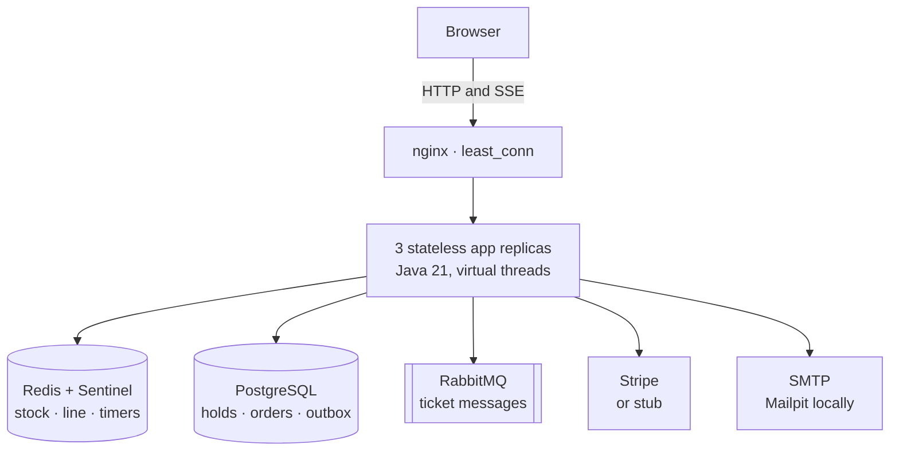

# FlashSeats

[](https://github.com/eshedhayoun/FlashSeats/actions/workflows/ci.yml)

**Author:** Eshed Hayoun

**10,000 people want 500 tickets, and they all arrive in the same second.** FlashSeats is a
high-concurrency ticket flash-sale engine that sells exactly the seats it has: none oversold, nobody
charged for a seat they did not get, and the buyers who miss out told quickly. It is a Java 21 /
Spring Boot 4 modular monolith running as three replicas behind nginx, with a React client.

**Measured:** 10,000 simulated buyers across five concurrent sales bought 2,500 of 2,500 seats, with
zero oversold and the stock invariant exact on every tier ([results](#results)).

## Demo

One command runs the whole system locally ([Getting started](#getting-started)). These screenshots
come from that cluster.

<!-- Optional: add a short GIF of the buyer journey here (docs/images/demo.gif). -->

<table>
  <tr>
    <td width="33%" valign="top"><p><b>Waiting room.</b> Live position over SSE; a refresh keeps the place.</p></td>
    <td width="33%" valign="top"><p><b>Declined card.</b> Seats stay held while the buyer retries.</p></td>
    <td width="33%" valign="top"><p><b>Ticket email.</b> PDF rendered and sent asynchronously via RabbitMQ.</p></td>
  </tr>
  <tr>
    <td width="33%" valign="top"><p><b>Event page.</b> Tiers with coarse availability, server-clock countdown.</p></td>
    <td width="33%" valign="top"><p><b>Choosing seats.</b> A ten-minute admission; reserving places a 5-minute hold.</p></td>
    <td width="33%" valign="top"><p><b>Operator console.</b> Create, pause, rebuild and delete sales.</p></td>
  </tr>
</table>

## Key features

- **No overselling, under any load or failure.** Seats are taken by one atomic Redis script; a lost
  stock counter stops the sale instead of reading as "sold out".
- **Exactly-once money.** Every settled charge ends confirmed or refunded, never both, even when
  checkout and the payment webhook race.
- **A fair, live waiting room.** Idempotent joins, live positions over Server-Sent Events, and
  admission paced so 10,000 buyers never exhaust the connection pool.
- **Horizontal scale.** Stateless replicas; 3–10 sales open at once; timers and seat restoration
  happen once per cluster, not once per replica.
- **The complete journey.** Event page → waiting room → seats → payment (stub or real Stripe with
  3-D Secure) → PDF ticket by email, plus an operator console to run sales.
- **Bot resistance** without punishing shared IPs: session-first rate limits, a per-IP backstop and
  reCAPTCHA on join.

## Tech stack and architecture

| Layer | Technology |
| :--- | :--- |
| **Backend** | Java 21 (virtual threads), Spring Boot 4.1, Spring Modulith 2.1, Spring Security |
| **Data** | PostgreSQL 16 (Flyway), Redis 7 with Sentinel |
| **Messaging** | RabbitMQ 3.13 with dead-letter queues |
| **Payments and resilience** | Stripe, Resilience4j circuit breakers, Bucket4j rate limits, reCAPTCHA v3 |
| **Fulfilment** | PDFBox, SMTP (Mailpit locally) |
| **Frontend** | React 18, TypeScript, MUI 6, Vite |
| **Infrastructure** | Docker Compose, nginx (`least_conn`), GitHub Actions CI, images on GHCR |
| **Testing and observability** | JUnit + Testcontainers, Vitest, Playwright, k6, Micrometer/Prometheus |



**PostgreSQL is the authority** for every lifecycle (holds, orders, payments, outbox). **Redis holds
fast, rebuildable state**: stock counters, the waiting room and timers. The backend is nine modules
that talk only through facades, and Spring Modulith verifies the boundaries at build time.

### Engineering highlights

| Problem | Solution | Proof |
| :--- | :--- | :--- |
| Thousands of buyers race for the last seat | One Redis Lua script reads, compares and decrements atomically ([`stock_reserve.lua`](src/main/resources/redis/stock_reserve.lua)) | [`StockReserveConcurrencyIT`](src/test/java/com/flashseats/catalog/StockReserveConcurrencyIT.java) |
| Three replicas see the same hold expire | A conditional `UPDATE … WHERE status = 'ACTIVE'`; only the winner restores the seats, after commit ([`TicketHoldRepository`](src/main/java/com/flashseats/hold/repository/TicketHoldRepository.java)) | [`HoldLifecycleIT`](src/test/java/com/flashseats/hold/HoldLifecycleIT.java) |
| Checkout and the webhook settle the same charge | Every order transition is a compare-and-set on the `orders` row ([`OrderCommitService`](src/main/java/com/flashseats/order/service/OrderCommitService.java)) | [`SettlementArbiterIT`](src/test/java/com/flashseats/order/SettlementArbiterIT.java) |
| 10,000 buyers would exhaust the pool | A Redis sorted-set waiting room with one cluster-wide admission allowance ([`PromotionWorker`](src/main/java/com/flashseats/queue/service/PromotionWorker.java)) | [`GlobalPromotionBudgetIT`](src/test/java/com/flashseats/queue/GlobalPromotionBudgetIT.java) |
| A buyer's live connection is on another replica | SSE, with promotions fanned out over Redis pub/sub ([`QueueBroadcaster`](src/main/java/com/flashseats/queue/service/QueueBroadcaster.java)) | [`fanout-check.sh`](docker/scripts/fanout-check.sh) |
| A confirmed order must always produce a ticket | Transactional outbox (`FOR UPDATE SKIP LOCKED`) → RabbitMQ → insert-then-send dedupe ([`OutboxRelay`](src/main/java/com/flashseats/order/service/OutboxRelay.java)) | [`OutboxRecoveryIT`](src/test/java/com/flashseats/order/OutboxRecoveryIT.java) |
| Nine modules must not tangle | Facade-only calls, verified by Spring Modulith | [`ModularityTests`](src/test/java/com/flashseats/app/ModularityTests.java) |

[Read the full architecture](docs/architecture.md): requirements, modules, the Redis key map,
every mechanism, invariants, failure behaviour and security.

## Results

Five concurrent sales of 500 seats, three replicas, k6 and the system sharing one ten-core laptop:

| Buyers | Sold | Oversold | Checkout p50 / p99 |
| :--- | :--- | :--- | :--- |
| 300 | 2,500 / 2,500 | 0 | 10 ms / 70 ms |
| 2,000 | 2,500 / 2,500 | 0 | 14 ms / 195 ms |
| 10,000 | 2,500 / 2,500 | 0 | 1.2 s / 7.6 s |

Correctness held at every load. At 10,000 buyers latency was bound by the laptop's CPU (shared with
k6), not by the system's connection pool. Multi-replica checks (promotion fan-out, exactly-once
hold expiry, Redis failover) and a real Stripe test-mode run also pass.
[Full results and how to reproduce them](docs/operations.md#5-load-testing).

## Getting started

### Prerequisites

- Docker with at least 8 GB of memory
- A POSIX shell (Git Bash on Windows)
- For development only: JDK 21 and Node 22

### Installation

```bash
git clone https://github.com/eshedhayoun/FlashSeats.git && cd FlashSeats
docker/scripts/demo.sh    # secrets, a three-replica cluster, two open sales; prints the admin password
```

The demo pulls the images CI published, or builds them if it cannot.

### Usage

| Open | What |
| :--- | :--- |
| http://localhost:8080 | The buyer journey: event page, waiting room, checkout, PDF ticket |
| http://localhost:8080/admin | The operator console (`admin` + the printed password) |
| http://localhost:8025 | Mailpit, where the ticket email arrives |

Payments use a stub by default: the checkout's card selector drives success, decline, provider
outage and 3-D Secure. Real Stripe is one setting away.

### Development and tests

```bash
cp .env.example .env
docker/scripts/dev-up.sh                    # infrastructure + one open sale
./mvnw spring-boot:run                      # API on :8080
cd frontend && npm install && npm run dev   # client on :5173
```

| Suite | Command | Result |
| :--- | :--- | :--- |
| Backend unit and integration | `./mvnw test` | 320 passing (needs Docker) |
| Frontend unit | `cd frontend && npm test` | 78 passing |
| Browser end-to-end | `cd frontend && npm run test:e2e` | 27 specs, desktop and mobile |

Configuration, Stripe, real SMTP, load testing, monitoring and the operator runbook are in
[the operations guide](docs/operations.md).

## Challenges and learnings

- **Correctness belongs in the data layer, not the flow.** The queue reduces load, but the only
  thing that prevents an oversell is one atomic operation on one owner's counter. Every guarantee is
  a constraint, a conditional update or an atomic script, never discipline at the call sites.
- **Correctness and performance are separate claims.** At 10,000 buyers the stock was exact while
  latency rose to seconds. An overloaded system must fail slow, never wrong.
- **Measure before tuning.** The 10,000-buyer drill once sold only 22–28 % of the seats. The cause
  was not the database but two new TCP connections per request on the hottest endpoint and unread
  instrumentation eating a quarter of the CPU. Fixing both reached 100 %.
- **One replica hides the hardest bugs.** Waiting-room notifications and seat restoration worked on
  one instance and broke on three; only multi-replica tests caught it.
- **Fail closed where money is involved.** A Redis restart stops affected sales until an operator
  rebuilds the counters, because a counter that may have lost writes must not keep selling.

Known limitations are listed in [operations](docs/operations.md#8-known-limitations).

## Documentation

| Document | Covers |
| :--- | :--- |
| [`docs/architecture.md`](docs/architecture.md) | Requirements, deployment, modules, Redis keys, mechanisms, invariants, failure behaviour, security, conventions |
| [`docs/api.md`](docs/api.md) | Every endpoint, the SSE events and the error codes |
| [`docs/operations.md`](docs/operations.md) | Running, configuration, tests, load testing, monitoring, runbook, limitations |
| [`frontend/README.md`](frontend/README.md) | The React client: its rules, views and tests |

## License

[MIT](LICENSE).
