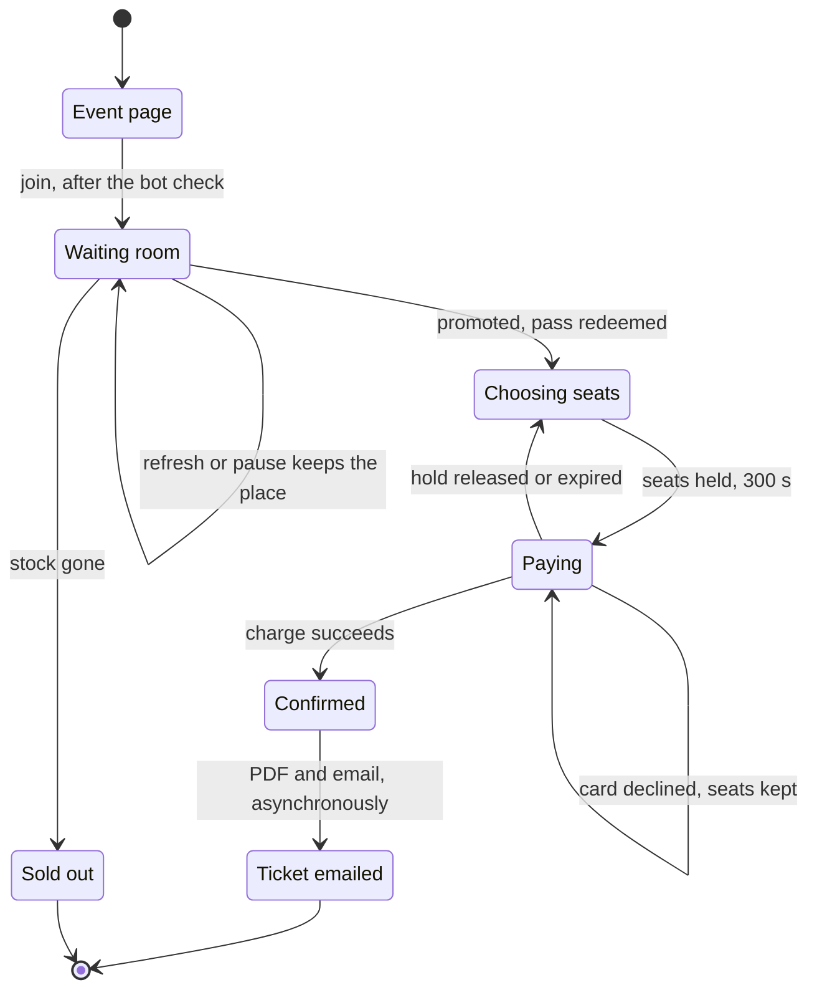
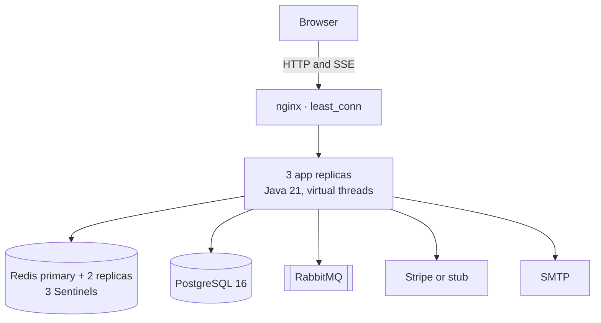
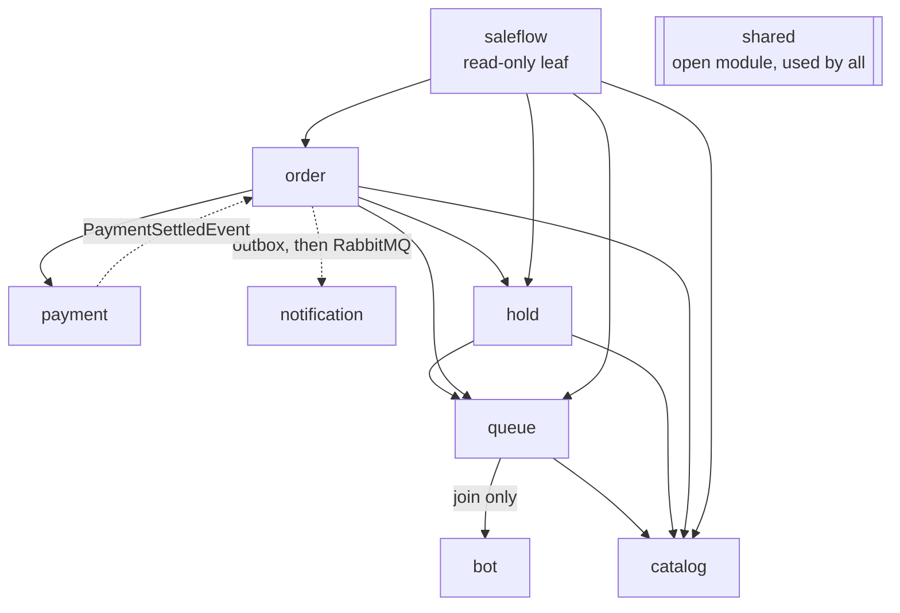
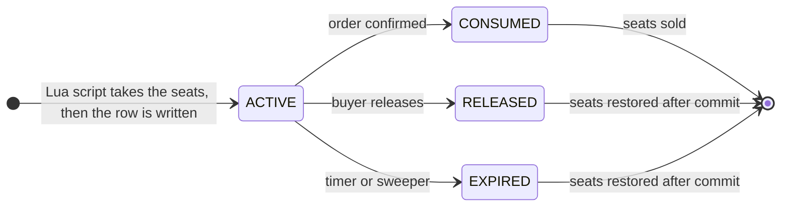
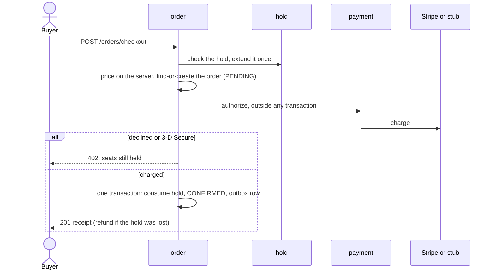

# Architecture

How FlashSeats is built: its parts, who owns what, and the mechanisms that keep a flash sale correct
across several servers. The API is in [`api.md`](api.md); running it is in
[`operations.md`](operations.md).

## 1. Goals and requirements

- **Never oversell, never charge without a ticket, never lose a sold seat**, under any load and on
  any number of replicas.
- **Pace the stampede.** 10,000 buyers must not reach checkout at once, or the connection pool is
  exhausted and nobody buys.
- **3–10 sales at once.** Every limit is shared across concurrent sales, not sized for one.
- **Stateless replicas.** Any replica serves any request; timers, notifications and seat restoration
  happen once, not once per replica.

### Actors

| Actor | What they do |
| :--- | :--- |
| **Buyer** | An anonymous visitor identified by a signed session cookie. Browses events, joins the waiting room, reserves seats, pays, and receives a PDF ticket by email |
| **Operator** | Signs in to the console at `/admin`, or calls the admin API directly. Creates and deletes sales, pre-warms, pauses and resumes them, rebuilds stock counters after a fault; through the API, also replays failed notifications and manages IP rules |
| **Payment provider** | The stub gateway or Stripe. Charges, refunds, and reports late settlements by webhook |

### Functional requirements

| ID | Requirement | How it is met |
| :--- | :--- | :--- |
| **FR-1** | A buyer sees every sale and when it opens | The event list and a countdown driven by the server's clock, not the device's |
| **FR-2** | Waiting is fair and visible | Joining is idempotent, so a refresh keeps the place; the position updates live over SSE, with polling as a fallback |
| **FR-3** | An admitted buyer chooses seats without racing anyone | A single-use pass (120 s) becomes an admission session (600 s); a hold (300 s) reserves the seats in one atomic step |
| **FR-4** | Paying is safe to retry | The price is computed on the server. A declined card keeps the seats for up to three attempts, 3-D Secure is supported, and a charge that lands after the seats are lost is refunded |
| **FR-5** | A purchase produces a ticket | A confirmed order is rendered as a PDF and emailed, and can be downloaded from the receipt page |
| **FR-6** | A reload or lost connection costs nothing | `GET /api/v1/sale/{eventId}/state` returns the buyer's exact position in the journey |
| **FR-7** | An operator creates and prepares sales | One form creates the event and its tiers, published and with stock prepared; a sale can be deleted until a minute before it opens, and is never edited |
| **FR-8** | An operator controls a live sale | Pause keeps every place in line; rebuild recounts the stock from the ledger after a fault; the console shows exact stock and warns when a sale would not sell |



*The buyer's journey. Three timers bound it: the pass (120 s), the admission session (600 s) in
which a buyer can compare tiers, release a hold and choose again, and the hold itself (300 s,
extended once while a payment is in progress).*

### Non-functional requirements

| Requirement | Target |
| :--- | :--- |
| **No oversell** | Zero, under any load, any failure, and any number of replicas |
| **Exactly-once money** | Every settled charge ends confirmed or refunded, never both and never neither |
| **Concurrency** | 3–10 sales open at the same time; 10,000 buyers across them |
| **Latency** | Checkout p99 under 200 ms at normal load |
| **Horizontal scale** | Stateless replicas; any replica can serve any request |
| **Fault behaviour** | Failures that could cause an oversell stop sales rather than guess. Load-shedding components fail open |
| **Abuse resistance** | Session-first rate limits with a loose per-IP backstop, so a campus behind one NAT address is not blocked; a challenge check on join |
| **Errors** | Every error is an RFC 7807 problem document with a stable error code |

### Scope

Payments use an in-process stub by default, which drives every branch a real provider can take:
success, decline, provider outage and 3-D Secure. Real Stripe runs in test mode behind
`STRIPE_ENABLED=true`. Email goes to a local Mailpit inbox; a real SMTP relay is configuration, not
code. Buyers are anonymous (a signed session cookie, no accounts). Operators share one account and
use the console over the same authenticated API as the scripts. Sales are created and deleted but
never edited or cancelled; failed notifications and IP rules are managed through the API only.

### Design principles

- **Correctness lives in the data layer.** The queue manages load; correctness comes from
  constraints, conditional updates and atomic scripts, never from call-site discipline.
- **Overload degrades latency, never correctness.** At 10,000 buyers latency rose to seconds while
  inventory stayed exact.
- **Fail closed on money and stock, fail open on load shedding.** A Redis restart pauses affected
  sales until counters are rebuilt from the ledger; an unreachable reCAPTCHA lets buyers through.
- **Distributed behaviour is tested distributed.** Notification fan-out and seat restoration are
  verified against a live three-replica cluster, which single-node tests cannot reach.

## 2. Deployment



| Component | Role |
| :--- | :--- |
| **nginx** | Load balancing (`least_conn`, because SSE connections are long and uneven), serves the React client, forwards the client address. SSE is unbuffered with a 1 h read timeout |
| **App replicas** | Spring Boot 4.1, Java 21. Virtual threads carry requests and SSE streams; the connection pool, not the thread count, is the concurrency limit |
| **PostgreSQL** | The ledger and the authority for every lifecycle: holds, orders, payments, outbox |
| **Redis** | The live stock counters, the waiting room, timers, rate limits, pub/sub. One primary with Sentinel, not Cluster: the key set is small and keyspace notifications are per node |
| **RabbitMQ** | Ticket fulfilment off the request path, with a dead-letter queue |

Redis runs `maxmemory-policy noeviction`, `notify-keyspace-events Ex` and AOF `everysec`. All three
are correctness settings: an evicted stock counter would resell sold seats, and the hold-expiry
listener needs the key-event channel.

## 3. Modules

A modular monolith with Spring Modulith. Modules call each other only through a `*Facade`
interface, read only their own tables and Redis keys, and the dependency graph is verified acyclic at
build time (`ModularityTests`).

| Module | Responsibility | PostgreSQL | Redis | Depends on |
| :--- | :--- | :--- | :--- | :--- |
| `bot` | Rate limits (session first, IP backstop), reCAPTCHA on join, IP rules, refusal audit | `ip_rules`, `bot_audit_logs` | `bot:*` | — |
| `catalog` | Events, tiers, sale windows, **inventory**, creating and deleting sales | `events`, `ticket_tiers` | `catalog:*` | — |
| `queue` | Waiting room, SSE, signed passes, admission control | — | `queue:*` | `catalog`, `bot` |
| `hold` | Time-bound reservations, settle-once stock restoration | `ticket_holds` | `hold:*` | `queue`, `catalog` |
| `payment` | Provider gateway, idempotency, webhooks, refunds | `payment_transactions`, `webhook_events` | `payment:*` | — |
| `order` | Checkout orchestration, the order ledger, outbox, stock rebuild | `orders`, `order_items`, `outbox_events` | — | `hold`, `catalog`, `payment`, `queue` |
| `notification` | PDF tickets, email, dead-letter replay | `notification_logs` | — | — (consumes RabbitMQ) |
| `saleflow` | Read-only "where am I in this sale" endpoint | — | — | `queue`, `hold`, `order`, `catalog` |
| `shared` | Open module: error codes, session identity, signed tokens, clock, PDF renderer | — | — | — |

`app` holds app-wide wiring (security, startup guards) and nothing depends on it. Two edges are not
facade calls: `payment` reports a settled charge to `order` as a Spring event (a facade call would
close a cycle), and `order` reaches `notification` through the outbox and RabbitMQ.



*Module dependencies. Solid arrows are facade calls; the dashed ones are a Spring event and a
RabbitMQ message, because as facade calls either would close a cycle.*

### Redis keys

`{e}` is an event id, `{t}` a tier id, `{sid}` a session id. **No key is the authority for
anything**: lose all of Redis and PostgreSQL plus an operator rebuild restore it.

| Key | Type | TTL | Purpose |
| :--- | :--- | :--- | :--- |
| `catalog:stock:{e}:{t}` | String | none | The live seat count |
| `catalog:vouch:{e}` | String | none | Which Redis instance (`run_id`) last derived this event's counters |
| `queue:waiting:{e}` | ZSET | sale end | The line; score is arrival, so rank is position |
| `queue:pass:{e}:{sid}` · `queue:passes:{e}` | String · ZSET | 120 s · sale end | Single-use promotion pass, and the live-pass index |
| `queue:admit:{e}:{sid}` · `queue:admissions:{e}` | String · ZSET | 600 s · sale end | Admission into the sale, and the live-admission index |
| `queue:events:{e}` | Pub/Sub | — | Fan-out to whichever replica holds a buyer's SSE stream |
| `queue:replay:{e}` · `queue:replay-seq:{e}` | ZSET · String | sale end | Last 256 broadcast frames, for SSE reconnect |
| `queue:availability:{e}` · `queue:closed:{e}` | String | retention | One replica announces each change, not every replica |
| `queue:promote:{e}` | String | 900 ms | Makes the promotion tick a singleton across replicas |
| `queue:budget` | String | one tick | The cluster-wide admission allowance shared by every open sale |
| `queue:exhausted:{e}` | String | sale end | Sold-out marker, derived from stock and cleared when stock returns |
| `hold:{token}` | String | hold TTL | Expiry timer; a hint, never an authority |
| `payment:inflight:{holdToken}` | String | 90 s | Duplicate-charge guard |
| `bot:rate:*` | Bucket4j | until refilled + 10 s | Rate-limit buckets |
| `bot:verified:{sid}` | String | 900 s | A passed challenge, remembered per session |

## 4. How it works

| Problem | Solution | Verified by |
| :--- | :--- | :--- |
| Thousands of buyers race for the last seat | One Redis Lua script reads, compares and decrements atomically ([`stock_reserve.lua`](../src/main/resources/redis/stock_reserve.lua)) | [`StockReserveConcurrencyIT`](../src/test/java/com/flashseats/catalog/StockReserveConcurrencyIT.java) |
| Every replica sees the same hold expire | A conditional `UPDATE … WHERE status = 'ACTIVE'`; only the winner restores the seats, after commit ([`TicketHoldRepository`](../src/main/java/com/flashseats/hold/repository/TicketHoldRepository.java)) | [`HoldLifecycleIT`](../src/test/java/com/flashseats/hold/HoldLifecycleIT.java), [`hold-expiry-check.sh`](../docker/scripts/hold-expiry-check.sh) |
| Checkout and the webhook settle the same charge | Every order transition is a compare-and-set on the `orders` row ([`OrderRepository`](../src/main/java/com/flashseats/order/repository/OrderRepository.java), [`OrderCommitService`](../src/main/java/com/flashseats/order/service/OrderCommitService.java)) | [`SettlementArbiterIT`](../src/test/java/com/flashseats/order/SettlementArbiterIT.java) |
| A traffic spike would exhaust the connection pool | A Redis sorted-set waiting room drawing on one cluster-wide admission allowance ([`PromotionWorker`](../src/main/java/com/flashseats/queue/service/PromotionWorker.java), [`promotion_budget.lua`](../src/main/resources/redis/promotion_budget.lua)) | [`GlobalPromotionBudgetIT`](../src/test/java/com/flashseats/queue/GlobalPromotionBudgetIT.java) |
| A buyer's live connection is on another replica | SSE, with promotions fanned out over Redis pub/sub ([`QueueBroadcaster`](../src/main/java/com/flashseats/queue/service/QueueBroadcaster.java), [`QueuePubSubListener`](../src/main/java/com/flashseats/queue/service/QueuePubSubListener.java)) | [`fanout-check.sh`](../docker/scripts/fanout-check.sh) |
| A confirmed order must always produce a ticket | Transactional outbox (`FOR UPDATE SKIP LOCKED`) to RabbitMQ, with insert-then-send deduplication ([`OutboxRelay`](../src/main/java/com/flashseats/order/service/OutboxRelay.java), [`NotificationLogRepository`](../src/main/java/com/flashseats/notification/repository/NotificationLogRepository.java)) | [`OutboxRecoveryIT`](../src/test/java/com/flashseats/order/OutboxRecoveryIT.java) |
| Nine modules must stay decoupled | Facade-only calls, verified by Spring Modulith | [`ModularityTests`](../src/test/java/com/flashseats/app/ModularityTests.java) |

### Inventory: an atomic reserve

`catalog:stock:{e}:{t}` is the only live count; PostgreSQL keeps no copy. A seat is taken by one Lua
script that reads, compares and decrements in a single atomic step:

```lua
local stock = redis.call('GET', KEYS[1])
if not stock then return -2 end                    -- no counter: a fault
if tonumber(stock) < quantity then return -1 end   -- genuinely sold out
redis.call('DECRBY', KEYS[1], quantity)
return 1
```

**A missing counter is a fault, not a cache miss.** Rebuilding it from `total_capacity` would
resurrect every sold seat, so the API answers `503 INVENTORY_UNAVAILABLE` and an operator runs a
locked rebuild from the ledger: capacity − sold − actively held.

**Every Redis write fails toward under-counting.** Redis cannot roll back with a SQL transaction, so
the decrement happens *before* the hold's transaction and the restore *after* the claim commits.
A failure then hides seats, which a rebuild recovers, rather than duplicating them, which nothing
recovers.

**A restarted Redis is not trusted.** Each event's counters are vouched for by the `run_id` of the
Redis that derived them. A restart or failover changes it, every replica refuses to sell that event,
and one rebuild releases it everywhere.

### Holds: restored exactly once

A hold lasts 300 s and ends in one of four ways: consumed by an order, released, expired by its timer,
or reclaimed by the sweeper. Every replica receives the Redis expiry event, so every ending runs the
same claim in PostgreSQL:

```sql
UPDATE ticket_holds SET status = ?, settled_at = now()
 WHERE hold_token = ? AND status = 'ACTIVE';   -- rowcount 1: this caller won
```

Only the winner returns the seats, after its commit; if the transaction rolls back, the seats stay
held rather than appearing twice. The expiry timer is an accelerator; the 10 s sweeper is the
guarantee, because keyspace notifications are at-most-once.



### The waiting room

- **Join** adds the buyer to a sorted set with `ZADD NX`, so a refresh keeps their place.
- **Promotion** runs once a second, as a singleton across replicas. It claims from one cluster-wide
  allowance (45 per tick) shared by every open sale, in shuffled order so no sale starves another,
  then admits up to `remaining × 1.5 − live passes − live admissions` for each sale.
- **Three nested timers**: a single-use pass (120 s) is exchanged for an admission (600 s), within
  which the buyer can compare tiers and place a hold (300 s, extended once by 120 s for payment).
- **Live updates** go over SSE. A promotion is published on Redis pub/sub so it reaches whichever
  replica holds the buyer's stream; `GET /queue/status` is the polling fallback.
- **Sold out** is derived from stock alone and reverses if seats return.

### Checkout: a settled charge ends exactly one way



- **Charge first, consume second.** The hold is consumed inside the order's commit, never before the
  charge.
- **No double charge**: the order is find-or-create on `UNIQUE(hold_token)`, a per-hold in-flight key
  guards concurrent submits, and the provider's idempotency key is scoped to the attempt.
- **Two paths, one outcome.** If the buyer leaves mid-payment, the provider's webhook settles the same
  charge. Both paths finish with a compare-and-set on the `orders` row, so a charge ends confirmed or
  refunded, never both. A refund is claimed on the row before money moves.
- **Prices are computed on the server**; no client value reaches a charge amount.

### Fulfilment: transactional outbox

The confirming transaction writes an `outbox_events` row. A relay on every replica claims rows with
`FOR UPDATE SKIP LOCKED`, publishes to RabbitMQ outside any transaction, and marks them only once the
broker confirms and routes them. The consumer claims `UNIQUE(order_number, kind)` before rendering
the PDF and sending, so a redelivery never sends a second ticket. Failed sends go to a dead-letter
queue that an operator can replay.

## 5. Invariants

1. `confirmed_sold + active_holds + remaining == total_capacity` for every tier. Exported per replica
   as `flashseats.stock.drift`; only a sustained non-zero value is a fault.
2. Seats are restored exactly once per hold, by the settle-once claim.
3. One hold becomes at most one order (`UNIQUE(hold_token)`), and no order exists without exactly
   one settled hold.
4. No charge without an order row; the card is charged before the hold is consumed.
5. A settled charge ends confirmed or refunded, decided by a compare-and-set on the order row.
6. A confirmed order always has an outbox row, so it always produces a ticket.
7. Module dependencies stay acyclic (`ApplicationModules.verify()`).

## 6. Failure behaviour

| Failure | Behaviour |
| :--- | :--- |
| Stock counter missing | `503 INVENTORY_UNAVAILABLE`, never "sold out"; operator rebuild |
| Redis restart or Sentinel failover | Affected sales stop selling until rebuilt; the console shows "Stock is not trusted" |
| Redis down | Checkout and holds fail closed (`503`); rate limiting fails open, counted |
| Connection pool exhausted | `503 SERVICE_BUSY` with `Retry-After`; seats of a hold that never began are returned |
| Card declined | `402`, the hold is kept, up to 3 attempts |
| Payment provider down | Circuit breaker opens, `503`, the hold is kept and no attempt is used |
| Buyer leaves mid-payment | The webhook confirms the order, or refunds if the seats are gone |
| reCAPTCHA unreachable | Join is allowed (fails open), rate limits still apply |
| Mail server down | Message dead-lettered; operator replays it |
| A replica dies mid-sale | No seats lost; in-flight orders resume on retry |

## 7. Security

- **Identity** is a signed `fsid` cookie (`HttpOnly`); no endpoint accepts a session id from a body,
  header or query string. Every signed token (session, queue pass, admission, receipt) carries its
  kind and its own secret.
- **Order access** needs the owning session or a signed, expiring receipt token; anyone else gets
  `404`, never `403`.
- **Operators** use HTTP Basic against one bcrypt-hashed account (`ROLE_ADMIN`). Metrics require it
  too; only `/actuator/health` is public.
- **Startup guard**: outside `dev` and `test`, the app refuses to start on default, short or shared
  secrets, or an unhashed admin password.
- **Client address** is the right-most `X-Forwarded-For` entry not added by a trusted proxy;
  the trusted-proxy list is empty by default.
- **Known gaps**: a single operator account; CSRF is off (a JSON API with an `HttpOnly` cookie;
  session reset accepts JSON only); order numbers are sequential; email addresses are stored in
  clear with no retention policy.

## 8. Code conventions

Every module has the same packages:

| Package | Holds | Visible to other modules |
| :--- | :--- | :--- |
| `facade` | The interface and the records that cross the boundary | yes |
| `exception` | `<Module>Errors`, plus any exception a `catch` names | yes |
| `event` | Events another module listens to | yes |
| `controller`, `dto` | Endpoints and request/response records | no |
| `service` | Logic and the facade implementation | no |
| `model`, `repository`, `config` | Entities, repositories, `@ConfigurationProperties` | no |

Rules:

- **A SQL transaction contains only SQL.** No HTTP, SMTP, broker, Redis write or rendering inside
  `@Transactional`; side effects run after commit.
- **Claims are conditional `UPDATE`s or `INSERT … ON CONFLICT DO NOTHING`** returning a rowcount,
  never `SELECT`-then-write.
- **Facades** are synchronous, never `@Transactional`, take and return records (never entities), and
  are implemented by the module's service.
- **Controllers only map**; logic lives in services. A separate bean exists only for a separate
  transaction.
- **No `synchronized`** on blocking paths (it pins virtual threads); use `ReentrantLock`. Distributed
  locks are `pg_try_advisory_xact_lock`.
- **Every `@Scheduled` job** is idempotent by claim or a singleton by lock, because it runs on every
  replica.
- **Every error** is an RFC 7807 problem with a stable `code` (see [`api.md`](api.md)).

Code comments cite design decisions as `ADR-NNN`. Those records are kept in git history, at the
`adr-archive` tag (`docs/00-architecture-decisions.md`).
